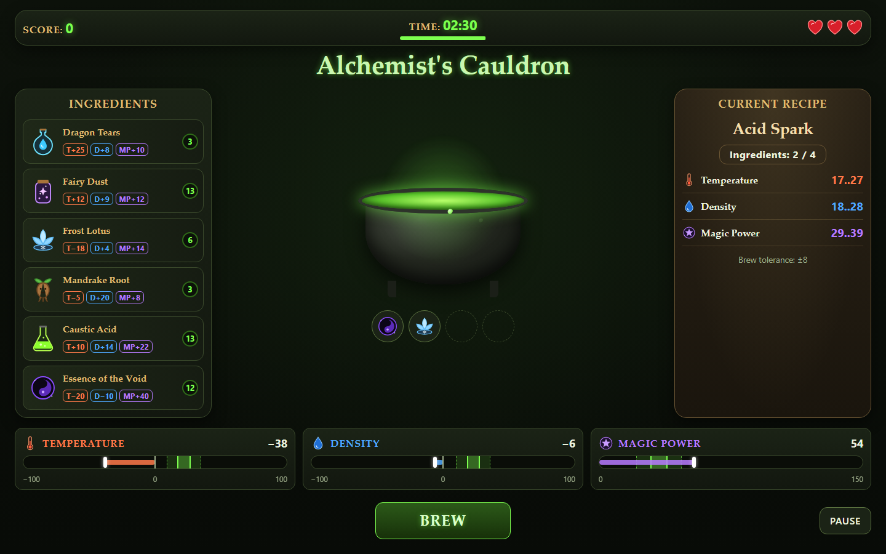

# 🧪 Alchemist's Cauldron

A browser potion-brewing mini-game built for the RS School qualifying stage.

Mix ingredients from a limited shelf, move three cauldron values — **Temperature**, **Density** and
**Magic Power** — into the target ranges of a random recipe, and brew potions before the time or the
lives run out.

**Play:** https://jahongir2109.github.io/alchemists-cauldron/



Task description:
[Alchemist's Cauldron](https://github.com/rolling-scopes-school/qualifying-stage/blob/main/tasks/game-alchemists-cauldron/README.md)

## Implemented

| Stage            | Story                                    | Status  |
| ---------------- | ---------------------------------------- | :-----: |
| Precondition 1   | Story 1 — Project Setup & Technical Base | ✅ Done |
| Level 1 — Basic  | US 1.1 Ingredient Shelf & Cauldron       | ✅ Done |
| Level 1 — Basic  | US 1.2 Cauldron Parameter Bars           | ✅ Done |
| Level 1 — Basic  | US 1.3 Recipe & Brewing Check            | ✅ Done |
| Level 1 — Basic  | US 1.4 Timer & Game Over                 | ✅ Done |
| Level 1 — Basic  | US 1.5 Pause                             | ✅ Done |
| Level 1 — Basic  | US 1.6 Leaderboard (Top-10)              | ✅ Done |
| Level 2 — Extend | US 2.1 Difficulty Selection              | ✅ Done |
| Level 2 — Extend | US 2.2 Auto-save & Continue Game         | ✅ Done |
| Level 3 — Full   | US 3.1 Drag & Drop                       | ✅ Done |
| Level 3 — Full   | US 3.2 Ingredient Tooltip                | ✅ Done |
| Level 3 — Full   | US 3.3 Chemical Reactions                | ✅ Done |
| Level 3 — Full   | US 3.4 Pour Out                          | ✅ Done |
| Level 3 — Full   | US 3.5 Visual Feedback                   | ✅ Done |
| Level 3 — Full   | US 3.6 Keyboard Shortcuts                | ✅ Done |

### Difficulty

| Setting                     | Easy  | Medium | Hard  |
| --------------------------- | :---: | :----: | :---: |
| Ingredients on shelf        |   4   |   6    |   8   |
| Max ingredients in cauldron |   4   |   4    |   5   |
| Starting time               | 180 s | 150 s  | 150 s |
| Recipe tolerance            |  ±12  |   ±8   |  ±5   |
| Lives                       |   5   |   3    |   3   |
| Score per brew              |  100  |  200   |  300  |
| Time bonus per brew         | +15 s | +10 s  | +5 s  |
| Reactions                   | none  |   2    |   3   |

**Medium** is the default and matches the full Level 1 rule set.

### Level 2

- **Difficulty selection** — the **Menu** on the start screen has **Easy**, **Medium** and **Hard**
  buttons with a short summary built from the same `DIFFICULTY_SETTINGS` object. The difficulty sets
  the shelf, cauldron limit, time, tolerance, lives, score, time bonus and the recipe rows. It cannot
  be changed during a run.
- **Leaderboard per difficulty** — one Top-10 list per difficulty, tabs for each list and a
  **Difficulty** column.
- **Auto-save** — `difficulty`, `score`, `timeLeft`, `lives`, `activeRecipe`,
  `cauldronIngredients`, `shelfStock` and `status` are saved after every change, on pause and when
  the page is closed.
- **Continue Game** — shown only when a valid unfinished save exists. It restores the saved stock
  (not re-rolled) and opens the game paused. Finished games and **Exit to Menu** delete the save, a
  new game overwrites it. Broken or edited data is validated, deleted and never crashes the game.

### Level 3

- **Drag & drop** — drag a shelf card into the cauldron (HTML5 `dragstart`, `dragover`,
  `dragleave`, `drop`). The cauldron glows as a drop zone only for a valid drag. Drops are ignored
  while paused or with a full cauldron; empty ingredients cannot be dragged. Clicks still work.
- **Tooltip** — cards show only the icon, name and stock. Hover or keyboard focus opens a tooltip
  with Temperature, Density and Magic Power (`+` / `−`). Near the right edge it opens to the left,
  near the bottom edge upward; it is hidden while paused.
- **Chemical reactions** — a typed `IReaction[]` catalog of all 15 reactions. Values are always
  recalculated from the ingredient list and the active reactions are applied to them. A reaction
  fires only when it turns from not active to active; one-time effects (time, life, clearing the
  cauldron) happen only then. Enabled sets:

  | Difficulty | Reactions                              |
  | ---------- | -------------------------------------- |
  | Easy       | none                                   |
  | Medium     | Bubbling, Solar Frost                  |
  | Hard       | Volatile Mix, Rooted Steam, Magma Flux |

- **Pour Out** — clears the whole cauldron for 10 seconds without losing a life; disabled for an
  empty cauldron, the ingredients are not returned.
- **Visual feedback** — success burst and a floating `+Ns` after a correct potion, explosion and a
  short screen shake after a wrong one, ingredient icons floating in the cauldron, smooth bars. CSS
  animations only, no `setTimeout` / `setInterval`.
- **Keyboard shortcuts** — only while a run is active: `1`–`8` add the ingredient from that shelf
  place, `B` brew, `O` pour out, `P` / `Esc` pause (`Esc` or **Resume** continues). Shortcuts never
  run on the start, pause and Game Over screens or while typing.

### Features

- **Start screen** — empty shelf and cauldron, score and time `0`, no lives, a centered
  **Start Game** button, **Help** (rules) and **Menu** (New Game, Leaderboard).
- **Shelf** — ingredient cards (real buttons) with an SVG icon, name and a stock badge (the 3 values
  are in the tooltip). Every new game gives each ingredient a random stock from 2 to 15. An ingredient with stock 0
  turns into an empty, dimmed, disabled slot.
- **Cauldron** — keeps the exact order of added ingredients, holds at most 4. When it is full, the
  shelf is blocked and the counter `Ingredients: 4 / 4` is highlighted.
- **Bars** — Temperature, Density and Magic Power with the recipe target zone, a value marker,
  smooth CSS transitions and a green glow when the value fits the range. Bars with negative values
  have the center line at 0.
- **Recipe & Brew** — a random Medium recipe from the fixed 20-recipe pool. **Brew** checks every
  value against the recipe range ±8. A correct potion: +200 score, +10 s (never above 150 s), new
  recipe. A wrong one: −1 life. Ingredients are spent in both cases.
- **Timer & Game Over** — `MM:SS` and a shrinking bar, calculated from `Date.now()` timestamps. Under
  15 seconds the timer is red and pulsing. The game ends at `00:00`, at 0 lives, or with
  **Out of ingredients** (shelf and cauldron both empty). The Game Over screen shows the reason, the
  final score, **Play again**, **Leaderboard** and **Main menu**.
- **Pause** — the **Pause** button or a hidden browser tab stops the timer and blurs the field. The
  dialog offers **Resume** and **Exit to Menu**.
- **Top-10** — a Top-10 result asks for a name (2–15 letters, digits, space, `_`, `-`). The table
  shows rank, name, score and date (`DD.MM.YYYY HH:MM`); equal scores keep the earlier result higher.
  **Clear Leaderboard** asks with an in-app dialog. Broken `localStorage` data never crashes the
  game.

## How to play

1. Open **Menu** and choose the difficulty (Medium by default).
2. Press **Start Game**. A recipe with 3 target ranges appears on the right.
3. Click, drag or press `1`–`8` to add ingredients. Hover a card to see its 3 values. Every
   ingredient adds its values to the cauldron and uses 1 portion of its stock. Watch out for
   reactions on Medium and Hard.
4. Watch the bars: the green zone is the recipe range, the dashed zone is the range with tolerance.
   A bar glows green when its value fits.
5. Press **Brew** (`B`) when all 3 bars glow. Wrong mixtures cost a life — use **Pour Out** (`O`)
   to throw a bad mix away for 10 seconds. The stock is limited and never refilled.
6. Use **Pause** any time. Switching to another tab pauses the game automatically. After a reload,
   **Continue Game** brings the unfinished run back.
7. Make the best score before the time, the lives or the ingredients run out, and enter your name
   in the Top-10.

## How to run

Requirements: Node.js 20+ and npm.

```bash
npm install        # install dependencies and git hooks
npm run dev        # start the dev server on http://localhost:5173
npm run build      # type check and production build into dist/
npm run preview    # preview the production build
```

Quality checks:

```bash
npm run lint           # ESLint (strict type-checked rules, no console, no any)
npm run format:check   # Prettier
npm run typecheck      # TypeScript
npm test               # Vitest unit tests for the game rules
```

Git hooks (Husky):

- `commit-msg` — commitlint checks the RS School commit message format
- `pre-push` — `npm run lint` and `npm run format:check`; a failed check blocks the push

Every push to a story branch (`story-1`, `story-2`, `story-3`) is built and deployed to GitHub Pages by GitHub Actions.

## Project structure

Game rules live outside the DOM code: `data`, `logic`, `state` and `storage` never touch the page,
only `ui` renders and listens to events.

```text
src/
  assets/icons/  separate SVG asset for every ingredient, parameter and life icon
  data/          fixed tables: ingredients, recipes, reactions, difficulty, bar scales
  logic/         pure rules: cauldron sums, stock, recipe picking, brew check, timer, Top-10
  state/         the game state object and the pure actions that change it
  storage/       safe localStorage helpers, the leaderboard and the game save
  styles/        CSS (variables, layout, components, animations)
  types/         shared TypeScript types and interfaces
  ui/            DOM rendering, dialogs and event handling
  main.ts        entry point
```

## Tech stack

- TypeScript in strict mode (no frameworks, no game engines, no UI libraries, no `any`)
- Vite as the bundler
- Plain CSS for the layout and animations, separate SVG files for icons
- ESLint, Prettier, Husky, commitlint, Vitest

## Notes

- US 1.3 mentions a 120 s cap for the time bonus, while US 1.4 and the difficulty table say the time
  never goes above the **start time**. The game uses the start time (150 s for Medium).
- All dialogs (pause, game over, leaderboard, confirmation, help, menu) are custom in-app dialogs
  built on the `<dialog>` element; the browser `alert()` / `confirm()` are never used.
